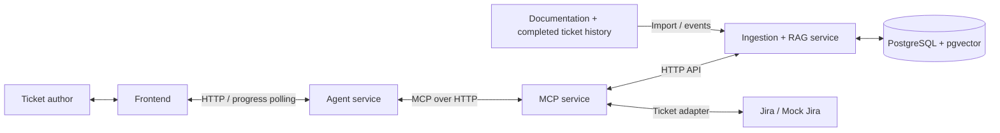

# TicketIQ — High-Level Architecture

## Overview

TicketIQ will use three Python services and a separate frontend. Each component has its own dependencies, container, and API boundary so the services can develop independently within one repository.

This document describes the proposed architecture, not services already implemented. It complements [Milestone 2](milestone-2.md), the [workflow example](workflow-example.md), and the [work allocation](work.md).

## Service Communication



The frontend communicates with the Agent service. The agent accesses ticket and context tools through MCP. The MCP service delegates retrieval to the RAG service and ticket operations to the Jira adapter.

The [assessment rubric](assessment-rubric.md) defines common verdicts, proposal eligibility, and evaluation. The [integration scenarios](integration-scenarios.md) connect these rules to payload fixtures and acceptance checks. The MCP → Agent approval callback is a separate internal HTTP path: Agent must serve it while awaiting MCP results. Administrative recovery is defined by the [reconciliation runbook](save-reconciliation.md).

## 1. Ingestion + RAG Service

**Owner:** Data Ingestion and RAG workstream.

Responsibilities:

- Ingest normalized fixtures initially, then support source events and updates.
- Normalize, chunk, and embed documentation and completed historical tickets.
- Maintain the retrieval index, including deduplication, updates, and deletions.
- Provide dense and hybrid retrieval with project filters and source citations.
- Enforce snapshot availability where source timestamps support it.

Expose an HTTP API for ingestion jobs, documentation search, historical-ticket search, and source document retrieval. Search results include source identifiers, excerpts, and citation metadata under an agreed schema.

Only this service accesses the retrieval index. Review targets and golden answers are excluded from that index.

The [MCP ↔ RAG contract](../src/contracts/mcp-rag/README.md) specifies scoped search, explicit temporal filtering, exact source citations, and paginated document reads pinned to an index generation and source version. Missing temporal metadata is reported rather than silently treated as historical evidence.

Ingestion and embedding run in a background worker so long imports do not block search requests. The worker can use the same codebase and Docker image as the RAG API, with a separate process entry point; it is not a separate team workstream.

## 2. MCP Service

**Owner:** MCP Server and Jira Integration workstream.

Responsibilities:

- Expose `get_ticket`, `search_docs`, `get_document`, `search_tickets`, and `update_ticket` through MCP.
- Delegate search and document reads to the RAG HTTP API.
- Read and update tickets through a Jira adapter, starting with a mock implementation.
- Validate tool inputs, project scope, and result limits.
- Enforce exact-proposal approval and ticket-version checks before updates.

Only this service writes to Jira. It does not implement retrieval algorithms or the conversation loop.

## 3. Agent Service

**Owner:** Model and Agent workstream.

Responsibilities:

- Integrate the model and orchestrate MCP tool calls.
- Assess ticket readiness and distinguish documented facts from unresolved decisions.
- Ask focused questions and draft grounded descriptions and acceptance criteria.
- Maintain conversation state, evidence references, proposals, and approval records.
- Expose the frontend API for analysis, clarification answers, proposal revisions, approval, and progress/results.
- Request approved updates through MCP and report success only after the update tool confirms it.

The Agent service owns the conversation API; MCP supplies its tools rather than replacing that API.

The [Agent ↔ MCP contract](../src/contracts/agent-mcp/README.md) specifies the five tools, trusted backend context, and structured results over MCP. The model receives four read tools; Agent invokes the write tool deterministically from the author's approved proposal, while MCP independently enforces the approval contract.

Agent publishes evidence references with assessments and questions, and accepts only ready, fully grounded proposals for approval in v1. MCP never silently refreshes a pinned retrieval run. Agent may restart an interactive analysis once with a new run ID and the same access/snapshot policy; evaluation runs retain their configured generation or fail explicitly.

Fine-tuning and baseline-versus-fine-tuned evaluation are separate jobs in this workstream, not operations run inside an interactive conversation. They use the agreed dataset partitions and golden references. Model serving may later move to a dedicated runtime if GPU or deployment requirements justify it, while the Agent API remains stable.

## 4. Frontend

**Owner:** Frontend workstream.

Responsibilities:

- Let the author select a ticket and inspect its current contents.
- Display assessments, sources, questions, and conversation progress.
- Collect clarification answers and revision requests.
- Show the exact proposed changes and collect explicit approval.
- Display confirmed update results or actionable errors.

The frontend is independently built and deployed. It communicates with the Agent service and can use mocked Agent API responses during development.

The [Frontend ↔ Agent contract](../src/contracts/frontend-agent/README.md) defines session state, clarification messages, exact proposal review, explicit approval, and recovery after refresh. V1 uses durable event polling; a streaming transport can be added later using the same event model.

## Refinement and Approval Flow

1. The author selects a ticket in the frontend.
2. The Agent service reads the ticket through MCP and retrieves relevant project context.
3. The agent asks about unresolved decisions; the author answers through the frontend.
4. The agent creates a proposal tied to the ticket version it reviewed and displays the proposed changes.
5. The author explicitly approves that proposal. A clarification answer alone is not approval.
6. The Agent backend records the approval against the exact proposal and author. The MCP service must be able to validate that record through an agreed backend contract; a client-supplied approval flag is insufficient.
7. The agent calls `update_ticket` with the approved changes, approval identifier, and expected ticket version.
8. MCP validates approval and version, performs the update, and returns the result. A changed proposal requires renewed approval; a stale ticket requires rereading and reviewing the proposal before retrying.
9. The frontend shows success only after a successful update result.

The trace retains the original ticket, evidence, clarification exchanges, proposal, approval, and update result.

For Jira Cloud, the version check is a preflight snapshot comparison, not an atomic conditional write. An external Jira edit can race with the save. The [MCP ↔ Jira Adapter contract](../src/contracts/mcp-jira-adapter/README.md) defines this limitation, field mappings, and update verification.

The [MCP ↔ Agent Approval Records contract](../src/contracts/mcp-agent-approvals/README.md) defines how MCP reserves approval through Agent's internal HTTP API and reports the write result. Agent owns the approval lifecycle; MCP owns the durable dispatch ledger. An uncertain write remains blocked for reconciliation rather than automatically releasing approval for another attempt.

## Repository and Local Development

Keep the services in one repository initially:

```text
src/
  services/
    rag/
    mcp/
    agent/
  frontend/
  contracts/
datasets/
docs/
  work.md
compose.yaml  # planned
```

- Each Python service has its own `pyproject.toml`, `Dockerfile`, configuration, and service-level checks.
- The frontend has its own dependencies and container/build configuration.
- Docker Compose starts the services, the RAG worker, and supporting storage for local integration.
- `src/contracts/` holds agreed API/tool schemas and example requests, responses, and errors.
- Conversation and approval records belong to the Agent service. Retrieval storage belongs to RAG. A shared PostgreSQL instance is acceptable initially, with separate ownership of schemas and no direct cross-service table access.
- Durable write-operation and dispatch records belong to MCP. Administrative reconciliation uses service-owned operations and acknowledgements, preserving both ledgers and blocking new saves until recovery is finalized.

## Contracts for Independent Development

Agree on these interfaces before connecting the implementations:

| Boundary | Contract |
|---|---|
| Frontend ↔ Agent | Conversation/session identifiers, ticket selection, messages, progress events, proposals, approval actions, and update results |
| Agent ↔ MCP | Tool inputs/outputs, project context, source references, approval identifiers, expected ticket versions, and errors |
| MCP ↔ RAG | Search queries, project/snapshot filters, result limits, source reads, and cited excerpts |
| MCP ↔ Agent approval records | Backend verification of author approval for the exact proposal and ticket version |
| MCP ↔ Jira adapter | Ticket fields, versions, approved changes, and read/update results |

Each owner provides representative mock responses so other workstreams can progress before the real dependency is available. Changes to these contracts are coordinated across the affected owners. Separate repositories are not required for independent development.
