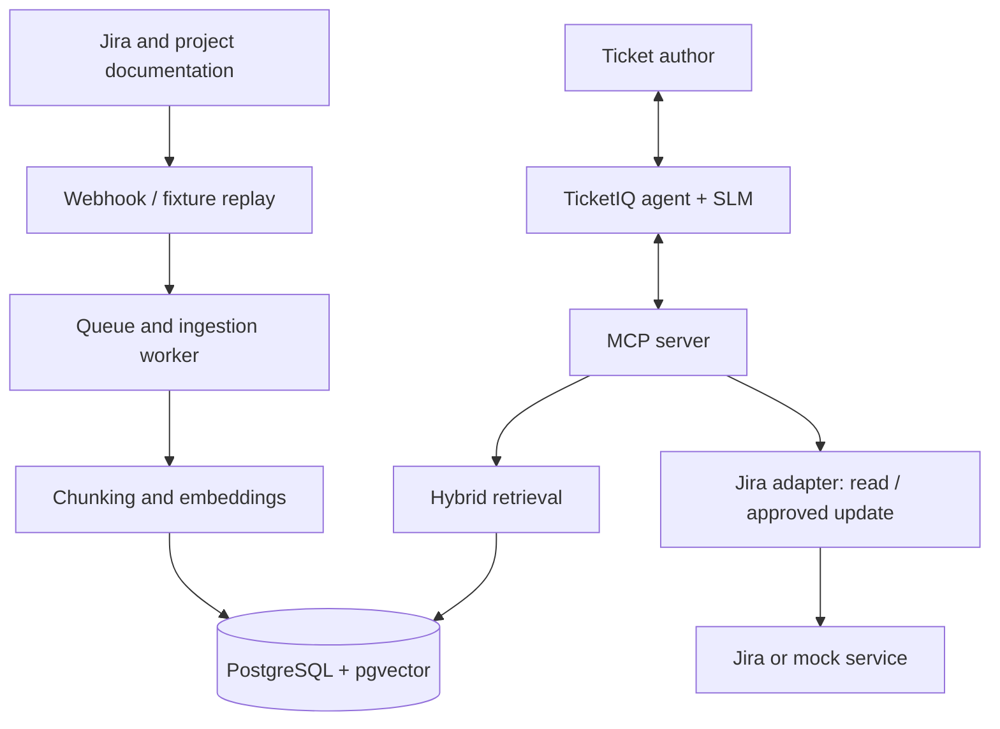
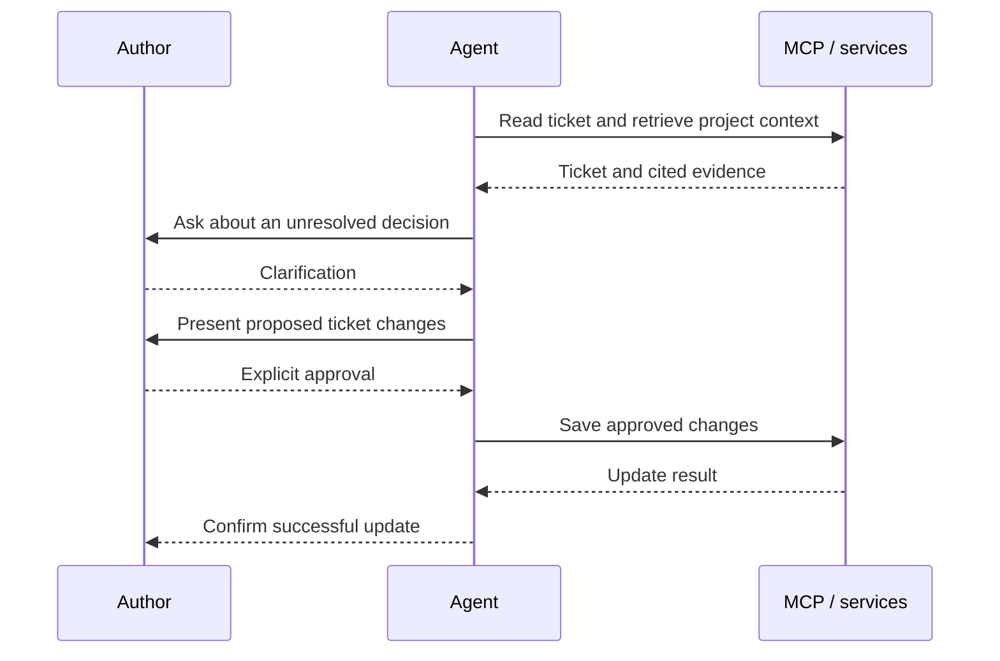

# Milestone 2: TicketIQ Architecture and Plan

## 1. Problem, data, and ingestion

TicketIQ checks whether a Jira ticket is ready for implementation, retrieves project context, asks about unresolved decisions, and proposes clearer requirements. **Updates require the author's approval of the proposed changes.**

Use the [normalized collection](../datasets/normalized/README.md): 590 documents, 1,100 review targets, and 40 historical tickets from all four datasets. Common fields (`title`, `label`, `doc_id`) and categories support one ingestion/evaluation pipeline. All data is synthetic.

Ingest new tickets and documentation through webhooks or fixture replay. A queued worker normalizes, chunks, and embeds content. Source IDs and hashes prevent duplicates; edits/deletions replace/remove stale chunks. Filter retrieval by project; enforce snapshot availability where source timestamps are known.

## 2. Proposed architecture and workflow

The worker maintains the index, retrieval finds evidence, and the agent manages assessment and clarification through MCP tools.

See the [complete workflow example](workflow-example.md). Clarification and update approval are separate steps.

## 3. Golden Dataset and evaluation

Each team member generated a synthetic dataset containing project documentation, tickets, and expected assessments. We combined these into `golden.jsonl`, with 1,100 reference assessments linked to the input tickets. We standardized five categories: resolved by documentation, unresolved, partially resolved, conflicting documentation, and already clear. Each assessment records whether clarification is needed, the expected questions, and available supporting evidence; part 1 also retains its individual decision annotations.

We separated reference answers from agent inputs and retrieval content to prevent answer leakage. Normalization checks confirmed document references and supplied exact quotations; PCON's evidence summaries remain distinct from quotations. These checks establish structural consistency. Human semantic review is planned before final evaluation.

We retained part 1's project-based splits and ToolNest's feature-based splits. PCON and TeamFlow's 400 tickets are currently unassigned; our plan is to group them by underlying topic or decision before splitting, reducing overlap between training and testing. Results will be reported by dataset.

Our evaluation will compare agent outputs with the references using readiness F1, retrieval Recall@k, citation correctness, clarification-topic coverage, unnecessary questions, and latency. The [assessment rubric](assessment-rubric.md) defines verdicts and scoring: resolved-by-documentation and already-clear cases count as Ready; the other categories require clarification. Primary readiness macro-F1 includes abstentions and operational failures as missed gold-class predictions, with coverage, abstention/failure rates, and conditional F1 reported separately. Additional [scripted integration scenarios](integration-scenarios.md) test author approval and ticket updates, which the current golden records do not cover.

## 4. RAG design and model choices

| Component | Proposed choice and rationale                                                                                   |
|---|-----------------------------------------------------------------------------------------------------------------|
| Chunking | Headings/ticket fields preserve structure. Compare fixed-size (~400 tokens, 60 overlap) and semantic splitting. |
| Embeddings | `Qwen3-Embedding-0.6B`: the existing compact candidate for local semantic retrieval.                            |
| Vector database | PostgreSQL + `pgvector`: vectors, metadata, project filters, and full-text search together.                     |
| Retrieval | Dense baseline vs hybrid vector + full-text search with rank fusion, combining meaning with exact identifiers.  |
| Agentic RAG | Choose docs, tickets, both, or neither; allow one follow-up search. Compare against fixed retrieval.            |
| Main SLM | `Qwen3.5-4B`: the existing candidate for tool use and local deployment.                                         |

## 5. Agent decisions and MCP tools

The agent selects sources, separates facts from open decisions, returns **Ready / Needs clarification / Insufficient evidence**, and drafts grounded changes.

Follow the shared [assessment rubric](assessment-rubric.md): concrete unresolved decisions require clarification, material missing context requires abstention, and v1 does not offer partial proposals for approval. Evidence must be available alongside assessments and questions before proposal review. MCP propagates unavailable-generation errors; Agent owns the bounded restart under the same scope and snapshot policy. Uncertain saves follow the [operator reconciliation runbook](save-reconciliation.md).

| MCP tool | Purpose |
|---|---|
| `get_ticket(ticket_id)` | Read current ticket fields and version. |
| `search_docs(project_id, query, top_k)` | Retrieve cited documentation excerpts. |
| `get_document(project_id, doc_id)` | Read a source in more detail. |
| `search_tickets(project_id, query, top_k)` | Retrieve relevant prior tickets. |
| `update_ticket(ticket_id, changes, approval_id, expected_version)` | Save the exact approved changes. |

MCP validates inputs, project scope, and result limits. Updates require recorded approval of the exact proposal and a matching ticket version. 

## 6. Weekly plan

| Week | Deliverable / experiment |
|---|---|
| 6 | Agree on architecture, initial corpus, rubric, and team responsibilities. |
| 7 | Review golden examples, assign missing topic-based splits, lock test data, and implement fixture ingestion/replay. |
| 8 | Build embeddings and storage; compare fixed-size, structure-aware, and semantic chunking. |
| 9 | Compare dense vs hybrid retrieval; check project isolation and update/delete handling. |
| 10 | Implement MCP tools, mock Jira adapter, and approval checks for updates. |
| 11 | Connect the SLM and clarification loop; compare no-RAG vs RAG and fixed vs agent-selected retrieval. |
| 12 | Demonstrate retrieval → clarification → approval → update; report validation metrics and failures. |
| 13 | Tune using validation results; optionally test reranking/model alternatives, then evaluate the frozen test set. |
| 14 | Present the working demo, architecture, experiment results, limitations, and next steps. |

