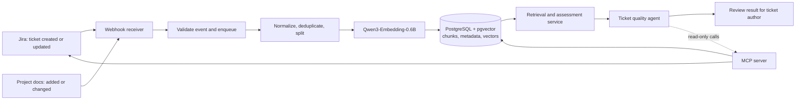

# Milestone 2: Proposed Architecture and Project Plan

**Project:** Jira ticket quality assistant (LLMs team)  
**Status:** Proposal for review  
**Planning horizon:** Week 6 milestone through the Week 14 progress final presentation

## 1. Project goal

We will build an assistant that reviews newly created Jira tickets against the relevant project documentation and existing tickets. It will decide whether a ticket is sufficiently clear and actionable, explain its decision with evidence, and ask the ticket author focused follow-up questions when information is missing or contradictory.

The assistant is advisory. It will not reject, rewrite, or update tickets automatically. A person remains responsible for deciding whether to revise and submit the ticket.

### Initial scope and assumptions

- Start with synthetic projects, documentation, and Jira-like tickets so evaluation is reproducible and does not depend on access to private project data.
- Implement a Jira adapter behind a small interface. The first end-to-end demo may use a mock Jira service and webhook payloads; connect a real Jira instance only if the team has suitable access and time.
- Ingest both ticket-created events and project-document changes. Updates and deletions must remove or replace stale indexed content.
- Treat evidence as project-scoped. Retrieval must not return documents or tickets belonging to another mock project.

## 2. Problem, data, and ingestion

### Task handled

Given a new ticket and its project context, return a structured assessment:

1. **Ready** or **Needs clarification**.
2. A short rationale tied to evidence, when evidence exists.
3. The missing, ambiguous, or conflicting fields (for example, goal, scope, acceptance criteria, dependencies, or reproduction steps).
4. One or more concise questions the author can answer.
5. A confidence or abstention signal when available evidence is insufficient.

“Good” means that a ticket is understandable and actionable under a written rubric, not that the proposed feature is desirable or technically correct.

### Synthetic corpus

Create several mock projects with deliberately different conventions, such as a web application, a data pipeline, and an internal service. For each project, generate and review:

- Project briefs, glossary, architecture notes, requirements, and ticket-writing guidance.
- Tickets with a range of quality: complete, missing key details, vague, contradictory, duplicate-like, and out of scope.
- Linked and unlinked tickets, including useful prior examples and misleading near matches.
- Change events for document updates and ticket edits, to exercise ingestion and re-indexing.

Keep source records in version-controlled JSON or Markdown fixtures. Each record should have a stable ID, project ID, source type, source URL or fixture path, update timestamp, and content hash. Generated examples are not ground truth until a human reviews their labels and expected questions.

### Ingestion flow

In production-shaped flow, a Jira webhook (or document-change event) is validated, acknowledged quickly, and placed on a background job queue. The worker normalizes the source, splits and embeds text, then upserts chunks and metadata in PostgreSQL. Stable IDs and content hashes make retries idempotent. A delete or edit event removes or replaces old chunks. Failed jobs are retryable and visible in logs.

For the prototype, the same pipeline can be invoked from fixture files and recorded webhook payloads. This keeps local development and evaluation deterministic while preserving the integration boundary.



## 3. Golden Dataset and evaluation

The Golden Dataset will measure ticket readiness, evidence selection, and the usefulness of clarification questions. We will create examples from the synthetic project fixtures rather than use the same model outputs as unquestioned answers.

### Dataset construction

1. Write a rubric defining required ticket qualities: goal/context, scope, acceptance criteria, dependencies, and any project-specific fields.
2. Generate candidate tickets by project and quality category, including edge cases and intentionally conflicting documentation.
3. Have at least one team member label each ticket and another review a sample (and disagreements) against the rubric.
4. Record expected status, missing fields, acceptable evidence IDs, and required/optional clarification topics. Expected answers can allow multiple valid phrasings; grade whether the question addresses the labeled gap.
5. Split by project or generation template, not randomly by near-duplicate ticket, to reduce leakage. Keep a small locked test split that is not used to tune prompts.
6. Version the dataset and rubric alongside the code. Record any changes to labels and why they changed.

### Evaluation measures

- Readiness classification: accuracy, precision, recall, and F1 for **Needs clarification**; report the confusion matrix.
- Evidence retrieval: Recall@k and whether the cited evidence actually supports the claim; measure cross-project leakage as a zero-tolerance error.
- Clarification quality: rubric-based coverage of missing fields, relevance, and answerability; human review for a sample.
- Grounding and safety: unsupported-claim rate, correct abstention when evidence is missing, and whether the assistant avoids claiming it changed Jira.
- Operations: ingestion success/retry behavior and end-to-end latency on the fixed evaluation environment.

Report results overall and by project/ticket category. Establish a simple rules-only or no-retrieval baseline before optimizing the LLM pipeline.

## 4. RAG design

### Initial choices and comparisons

| Component | Starting choice | Comparison / rationale |
|---|---|---|
| Chunking | Structure-aware splitting at headings and ticket fields, with a fixed-size fallback around 400 tokens and about 60 tokens overlap | Compare against semantic splitting. Structure preserves sections and ticket fields; fixed-size is a reproducible baseline; semantic splitting may keep related ideas together but adds complexity. Tune sizes on the development split only. |
| Embeddings | `Qwen/Qwen3-Embedding-0.6B` | The team selected this compact, open-weight embedding model. Measure retrieval on our own corpus; compare with at least one smaller readily runnable baseline if compute permits. |
| Vector store | PostgreSQL with `pgvector` | Keeps vectors, source metadata, project filters, and ordinary application data together. Add PostgreSQL full-text search for the hybrid baseline. |
| Retrieval | Dense-only baseline, then hybrid dense + PostgreSQL full-text retrieval with rank fusion | Tickets contain both semantic descriptions and exact identifiers, names, and error strings. Hybrid retrieval should help with both, but must earn its added complexity on Recall@k and evidence quality. |
| Reranking | Optional second-stage reranker after establishing hybrid baseline | Compare no reranker against a compact reranker only if retrieval errors justify the latency and compute. |
| Answering | Grounded answer with source IDs and an explicit “insufficient evidence” path | The agent should distinguish missing ticket information from missing project knowledge and ask a focused question instead of inventing a policy. |

The proposed delivery target is hybrid RAG, while the experiment plan preserves a dense baseline for comparison. Agentic retrieval is a later target: the agent may decide whether to search documentation, prior tickets, or both, and may perform a second targeted search if the first evidence set is weak. It should not search indefinitely; cap retrieval rounds and abstain when evidence remains insufficient.

### Retrieval and assessment sequence

```mermaid
sequenceDiagram
    participant Jira
    participant Agent
    participant MCP
    participant Search as Retrieval service
    participant DB as PostgreSQL / pgvector
    participant LLM as Qwen3.5-4B
    Jira->>Agent: New ticket event / ticket ID
    Agent->>MCP: get_ticket(ticket_id)
    MCP->>Jira: Read ticket and project ID
    Jira-->>MCP: Ticket fields
    MCP-->>Agent: Normalized ticket
    Agent->>LLM: Assess ticket and choose evidence need
    LLM-->>Agent: Search docs, tickets, both, or no search
    Agent->>MCP: search_docs / search_tickets
    MCP->>Search: Query + project scope + filters
    Search->>DB: Hybrid retrieval
    DB-->>Search: Ranked chunks with source metadata
    Search-->>MCP: Evidence snippets and IDs
    MCP-->>Agent: Evidence
    Agent->>LLM: Decide readiness; draft grounded questions
    LLM-->>Agent: Structured assessment
    Agent-->>Jira: Advisory result with evidence references
```

## 5. Agent, tools, and MCP boundary

### Agent decisions

The agent will:

- Decide whether the ticket can be assessed from its fields alone or needs project context.
- Choose documentation search, prior-ticket search, both, or neither; request one bounded follow-up search when needed.
- Compare the ticket with retrieved, project-scoped evidence and apply the readiness rubric.
- Return **Ready**, **Needs clarification**, or **Insufficient evidence**, with concise rationale and source references.
- Ask only questions that target missing or conflicting information.

The agent will not create, edit, transition, or comment on Jira issues in the initial scope. Tool calls are read-only; the user-facing result can be copied into Jira or used to guide a human edit.

### MCP server tools

Expose small, typed, read-only tools through an MCP server. Candidate tool definitions:

| Tool | Inputs | Result |
|---|---|---|
| `get_ticket` | `ticket_id` | Normalized fields, project ID, links, and update timestamp |
| `search_docs` | `project_id`, `query`, optional `top_k` | Ranked document excerpts with source IDs, titles, and links |
| `get_document` | `project_id`, `document_id` | Current document content or a bounded relevant section |
| `search_tickets` | `project_id`, `query`, optional ticket filters and `top_k` | Ranked prior-ticket excerpts with IDs and status |

The MCP server will validate inputs, enforce project scope, limit returned content, and expose errors without leaking credentials. The Jira adapter owns Jira authentication and API calls; the internal document adapter reads the project documentation source. The retrieval service owns chunk/vector lookup. The agent receives only the tools needed for the current assessment. Keep write tools out of the initial server configuration.

## 6. Model choices

- **Main SLM candidate: Qwen3.5-4B.** The team selected it for its tool-use support, long context, and open weights. The official model card documents tool-use configuration and a 262,144-token native context window; actual serving requirements and quality must be checked on the team's hardware. We will test structured output and tool selection on our Golden Dataset before treating it as a final choice. [Official Qwen3.5-4B model card](https://huggingface.co/Qwen/Qwen3.5-4B)
- **Embedding model: Qwen3-Embedding-0.6B.** Use it for local semantic retrieval, subject to measured retrieval quality. [Official Qwen3-Embedding-0.6B model card](https://huggingface.co/Qwen/Qwen3-Embedding-0.6B)
- **Fallback / comparison.** If Qwen3.5-4B cannot meet latency or structured tool-call reliability on available hardware, compare a smaller locally runnable instruction model. If the selected embedding model underperforms, compare a second compact embedding model on the same frozen retrieval set. Record exact model revisions, quantization, runtime, and hardware with each result.

Model choice is provisional until measured against the project-specific evaluation set. We will favor reliable classification, grounded questions, and correct abstention over general benchmark claims.

## 7. Week-by-week plan

Weeks are the course's numbered weeks. Week 6 is the current Milestone 2 deadline; Week 12 is the pre-Christmas GitHub progress review; Week 14 ends with the progress final presentation. Each week's code, fixtures, and experiment notes should be committed to GitHub as work is completed.

| Week | Planned work and experiments | Evidence / checkpoint |
|---|---|---|
| **6 — now / Milestone 2** | Submit this architecture and plan. Agree on readiness rubric, repository layout, owners, and mock project themes. Create issue list and initial synthetic-data schema. | Reviewed proposal, rubric draft, project issues, and a small committed fixture sample. |
| **7** | Build synthetic project/document/ticket fixtures and the first labeled Golden Dataset slice. Implement webhook payload receiver or replay harness and normalized source schema. | Ingestion walkthrough; stable IDs, project IDs, and sample labels in GitHub. |
| **8** | Implement document/ticket parsing, structure-aware and fixed-size chunking, embeddings, and PostgreSQL/pgvector storage. Experiment: fixed-size vs structure-aware vs semantic chunking on a small retrieval set. | Reproducible chunking comparison with Recall@k and example failures. |
| **9** | Implement project-scoped dense retrieval and PostgreSQL full-text search. Experiment: dense-only vs hybrid retrieval; inspect exact-name and semantic queries. | Retrieval metrics and evidence examples; cross-project isolation cases. |
| **10** | Build read-only MCP server tools and Jira/document adapters; use a mock Jira API if real access is unavailable. Implement tool input validation and bounded results. | End-to-end tool-call demo with fixture data and documented tool schemas. |
| **11** | Implement Qwen3.5-4B assessment flow and structured output; connect retrieved evidence to readiness decision and clarification questions. Experiment: no-RAG baseline vs hybrid RAG; test whether agent selects docs, tickets, or both appropriately. | Golden Dataset development results, agent traces, and failure analysis. |
| **12 — pre-Christmas review** | Stabilize a demonstrable vertical slice. Expand and review labels; run full current evaluation and log results. Fix high-impact ingestion, retrieval, and tool-call failures. | GitHub history shows incremental implementation; tagged demo, current metrics, and known limitations ready for instructor review. |
| **13** | Run targeted improvements based on Week 12 findings. Experiment: compare prompt/rubric variants and, if justified, reranking or a compact model alternative. Freeze a held-out test set and evaluate once. | Comparison table with model/config revisions, test metrics, and selected configuration rationale. |
| **14 — progress final presentation** | Polish the end-to-end demo and architecture diagrams. Summarize system behavior, experiments, measured results, limitations, and next steps. | Presentation-ready demo and final progress report; repository contains reproducible fixtures, evaluation instructions, and experiment records. |

### Commitments and risk controls

- The Week 12 review should show a working vertical slice, not only a plan: synthetic event → ingest/index → retrieve evidence → assess ticket → present advisory result.
- Keep a working baseline at each stage so that a delayed Jira integration, unavailable GPU, or weak model result does not block evaluation. Mock adapters and CPU-compatible paths are acceptable for the prototype if clearly documented.
- Freeze the test split before prompt/model tuning. Keep a run log with dataset version, code commit, model revision, retrieval configuration, and metrics.
- If schedule slips, prioritize an end-to-end, project-scoped, read-only assessment and a credible evaluation over adding more tools or model variants.

## 8. Proposed repository artifacts

- `docs/milestone-2-architecture-and-plan.md` — this proposal and diagrams.
- `data/` or `fixtures/` — versioned synthetic projects, documents, tickets, and webhook events.
- `evaluation/` — rubric, Golden Dataset, evaluation script, and run summaries.
- `experiments/` — configuration and results for chunking, retrieval, and model comparisons.
- `src/` — ingestion, retrieval, MCP server, Jira adapter, and assessment orchestration.

